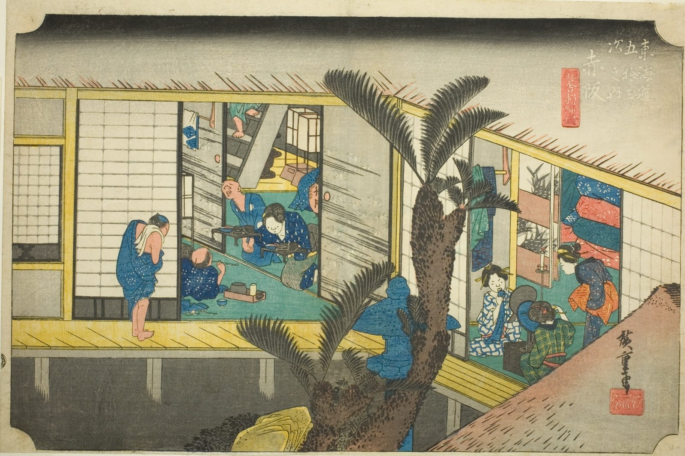

::: {.trail}
[[places|The Road]] / [[Aichi]] / Akasaka
:::

*Utagawa Hiroshige, 1833–34, colour woodblock. [Full size](../assets/aic-25720.jpg)*

::: {.eyebrow}
Station 36 · Akasaka, Toyokawa, Aichi
:::

::: {.numeral}
36

of 53
:::

::: {.slip}
赤坂
:::

::: {.subtitle}
*Akasaka, ryosha shofu no zu*
:::

> Serving women prepare an evening meal and entertain guests in the courtyard of an inn at Akasaka.

### Where it falls on the road

::: {.ruler}
76.7 ri, about 301 km from Nihonbashi.
:::

::: {.credit}
Art Institute of Chicago · Public domain (CC0) · [Source record](https://www.artic.edu/artworks/25720)
:::
