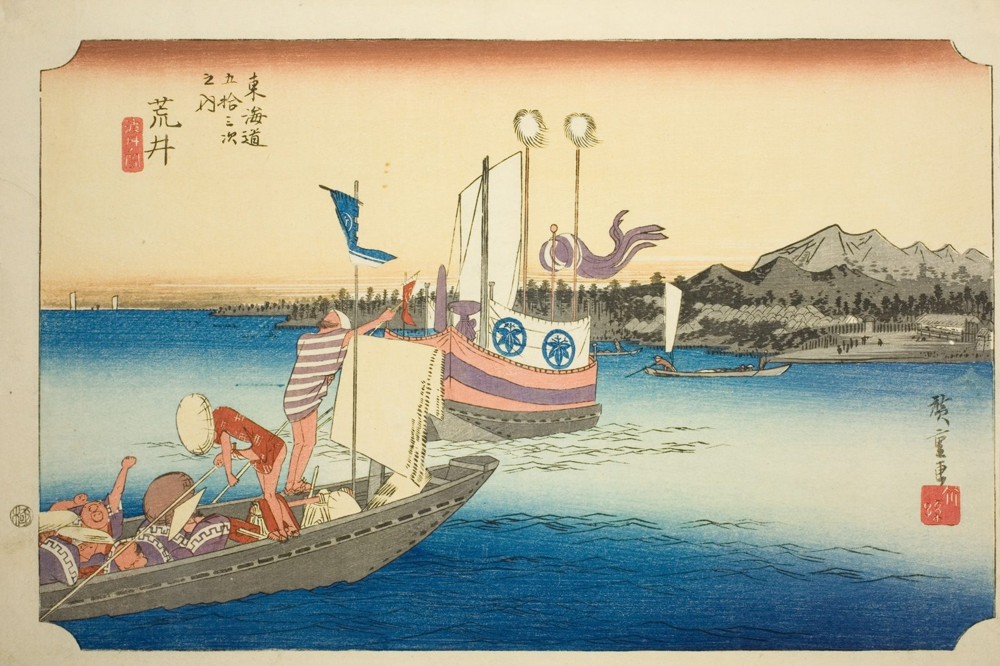

::: {.trail}
[[places|The Road]] / [[Shizuoka]] / Arai
:::

*Utagawa Hiroshige, 1833–34, colour woodblock. [Full size](../assets/aic-18264.jpg)*

::: {.eyebrow}
Station 31 · Arai, Kosai, Shizuoka
:::

::: {.numeral}
31

of 53
:::

::: {.slip}
新居
:::

::: {.subtitle}
*Arai, watashibune no zu*
:::

> A daimyo's ferry approaches the shore at the Arai checkpoint, one of the Tōkaidō's most heavily guarded barrier stations.

### Where it falls on the road

::: {.ruler}
69 ri, about 271 km from Nihonbashi.
:::

::: {.credit}
Art Institute of Chicago · Public domain (CC0) · [Source record](https://www.artic.edu/artworks/18264)
:::
