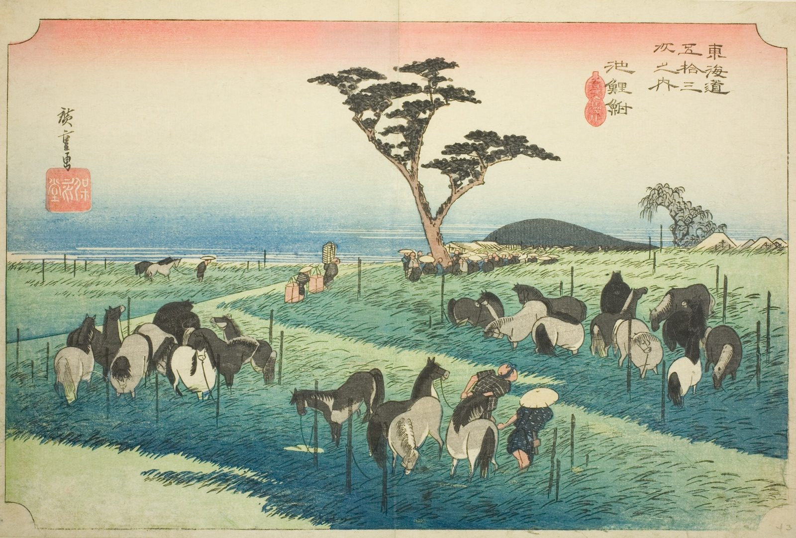

::: {.trail}
[[places|The Road]] / [[Aichi]] / Chiryū
:::

*Utagawa Hiroshige, 1833–34, colour woodblock. [Full size](../assets/aic-25738.jpg)*

> Horses are bought and sold in an open field outside Chiryū during the town's famous early-summer horse market.

### Where it falls on the road

::: {.ruler}
84.5 ri, about 332 km from Nihonbashi.
:::

::: {.credit}
Art Institute of Chicago · Public domain (CC0) · [Source record](https://www.artic.edu/artworks/25738)
:::
