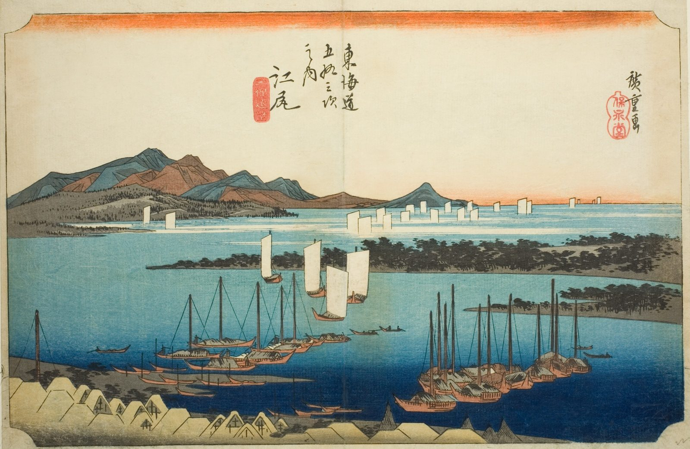

::: {.trail}
[[places|The Road]] / [[Shizuoka]] / Ejiri
:::

*Utagawa Hiroshige, 1833–34, colour woodblock. [Full size](../assets/aic-25625.jpg)*

::: {.eyebrow}
Station 18 · Shimizu-ku, Shizuoka City
:::

::: {.numeral}
18

of 53
:::

::: {.slip}
江尻
:::

::: {.subtitle}
*Ejiri, Miho enbo*
:::

> Boats sail Suruga Bay off Ejiri as the pine-covered spit of Miho stretches into the distance beneath Mount Fuji.

### Where it falls on the road

::: {.ruler}
42 ri, about 165 km from Nihonbashi.
:::

::: {.credit}
Art Institute of Chicago · Public domain (CC0) · [Source record](https://www.artic.edu/artworks/25625)
:::
