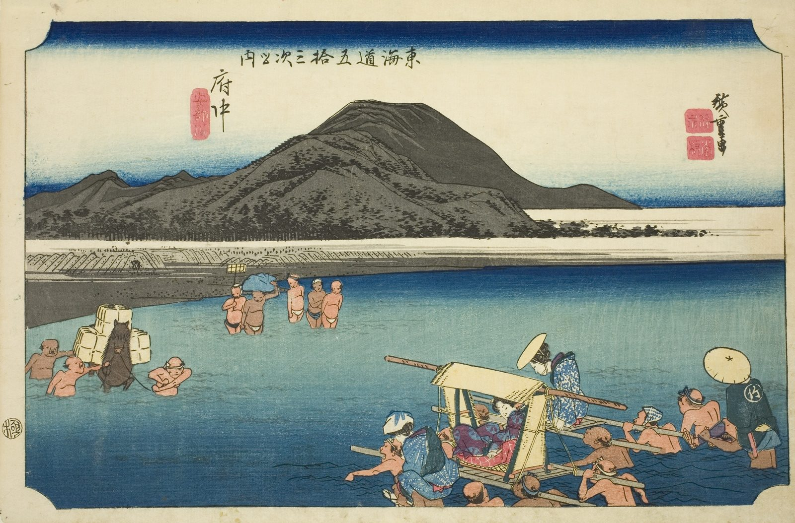

::: {.trail}
[[places|The Road]] / [[Shizuoka]] / Fuchū
:::

*Utagawa Hiroshige, 1833–34, colour woodblock. [Full size](../assets/aic-18257.jpg)*

::: {.eyebrow}
Station 19 · Aoi Ward, Shizuoka City
:::

::: {.numeral}
19

of 53
:::

::: {.slip}
府中
:::

::: {.subtitle}
*Fuchu, Abekawa*
:::

> Porters carry passengers and palanquins on their shoulders across the wide, shallow Abe River outside Fuchū.

::: {.look}
### What to look for

Count the ways of crossing: some travellers are carried on shoulders, some in a palanquin.
:::

### Where it falls on the road

::: {.ruler}
44.7 ri, about 175 km from Nihonbashi.
:::

::: {.credit}
Art Institute of Chicago · Public domain (CC0) · [Source record](https://www.artic.edu/artworks/18257)
:::
