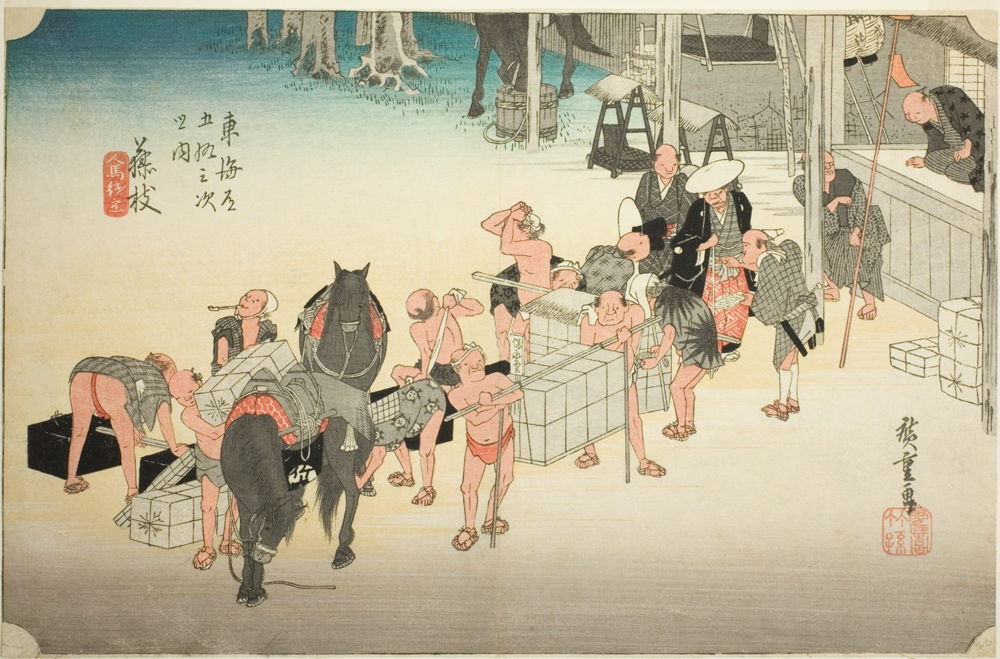

::: {.trail}
[[places|The Road]] / [[Shizuoka]] / Fujieda
:::

*Utagawa Hiroshige, 1833–34, colour woodblock. [Full size](../assets/aic-25649.jpg)*

::: {.eyebrow}
Station 22 · Fujieda, Shizuoka
:::

::: {.numeral}
22

of 53
:::

::: {.slip}
藤枝
:::

::: {.subtitle}
*Fujieda, jinba tsugitate*
:::

> Porters and packhorses are exchanged at the station entrance to Fujieda as a new relay team takes over the baggage.

### Where it falls on the road

::: {.ruler}
49.8 ri, about 196 km from Nihonbashi.
:::

::: {.credit}
Art Institute of Chicago · Public domain (CC0) · [Source record](https://www.artic.edu/artworks/25649)
:::
