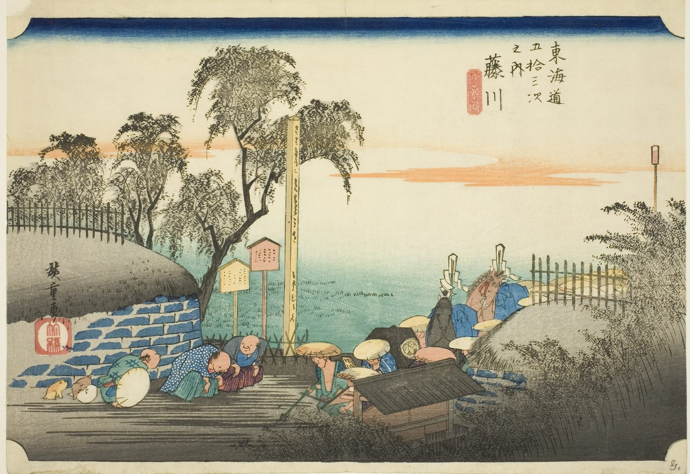

::: {.trail}
[[places|The Road]] / [[Aichi]] / Fujikawa
:::

*Utagawa Hiroshige, 1833–34, colour woodblock. [Full size](../assets/aic-20264.jpg)*

::: {.eyebrow}
Station 37 · Fujikawa, Okazaki, Aichi
:::

::: {.numeral}
37

of 53
:::

::: {.slip}
藤川
:::

::: {.subtitle}
*Fujikawa, bohana no zu*
:::

> A small daimyo procession passes a solitary teahouse at the edge of Fujikawa as evening approaches.

### Where it falls on the road

::: {.ruler}
79 ri, about 310 km from Nihonbashi.
:::

::: {.credit}
Art Institute of Chicago · Public domain (CC0) · [Source record](https://www.artic.edu/artworks/20264)
:::
