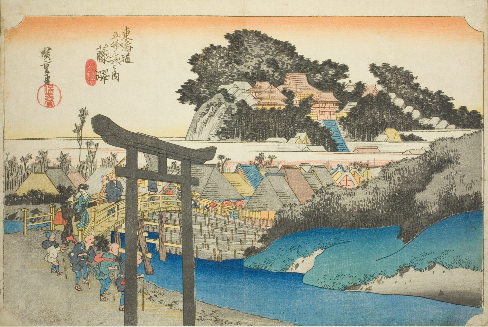

::: {.trail}
[[places|The Road]] / [[Tokyo & Kanagawa]] / Fujisawa
:::

*Utagawa Hiroshige, 1833–34, colour woodblock. [Full size](../assets/aic-25569.jpg)*

::: {.eyebrow}
Station 6 · Fujisawa, Kanagawa
:::

::: {.numeral}
6

of 53
:::

::: {.slip}
藤沢
:::

::: {.subtitle}
*Fujisawa, Yugyoji*
:::

> Pilgrims and travelers cross a bridge into Fujisawa beneath the gate of Yugyōji, the town's namesake temple, seen on the hill above.

### Where it falls on the road

::: {.ruler}
12.5 ri, about 49 km from Nihonbashi.
:::

::: {.credit}
Art Institute of Chicago · Public domain (CC0) · [Source record](https://www.artic.edu/artworks/25569)
:::
