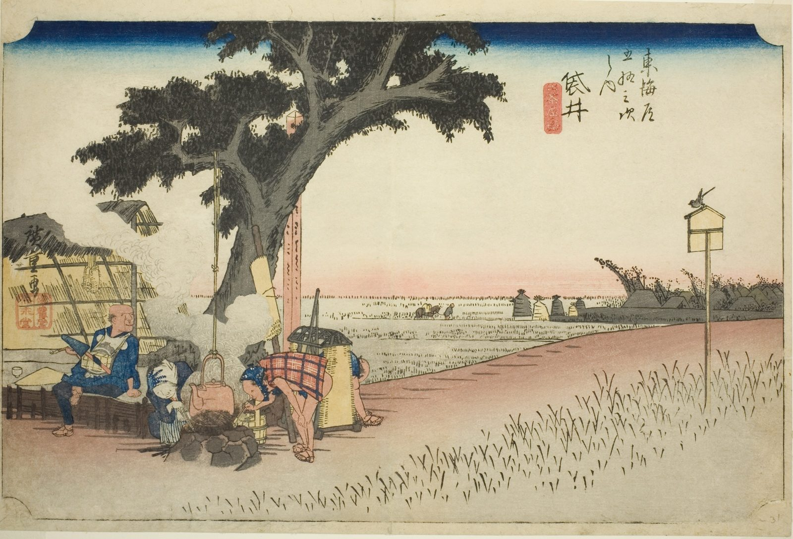

::: {.trail}
[[places|The Road]] / [[Shizuoka]] / Fukuroi
:::

*Utagawa Hiroshige, 1833–34, colour woodblock. [Full size](../assets/aic-25668.jpg)*

> Travelers rest at an open-air tea stall on the plain outside Fukuroi, one of the smaller stations on the route.

### Where it falls on the road

::: {.ruler}
59 ri, about 232 km from Nihonbashi.
:::

::: {.credit}
Art Institute of Chicago · Public domain (CC0) · [Source record](https://www.artic.edu/artworks/25668)
:::
