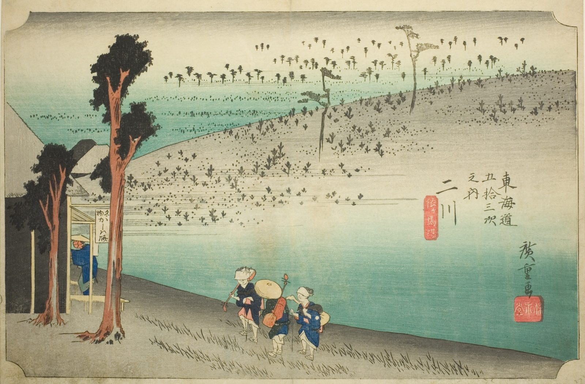

::: {.trail}
[[places|The Road]] / [[Aichi]] / Futagawa
:::

*Utagawa Hiroshige, 1833–34, colour woodblock. [Full size](../assets/aic-25710.jpg)*

::: {.eyebrow}
Station 33 · Futagawa, Toyohashi, Aichi
:::

::: {.numeral}
33

of 53
:::

::: {.slip}
二川
:::

::: {.subtitle}
*Futakawa, Sarugababa*
:::

> A modest teahouse stands alone on the windswept Sarugababa plateau outside Futagawa as a samurai procession passes.

### Where it falls on the road

::: {.ruler}
72.1 ri, about 283 km from Nihonbashi.
:::

::: {.credit}
Art Institute of Chicago · Public domain (CC0) · [Source record](https://www.artic.edu/artworks/25710)
:::
