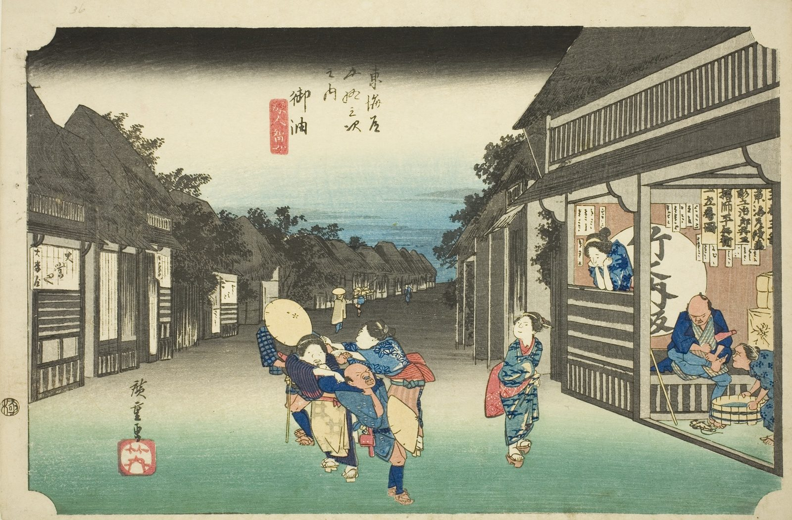

::: {.trail}
[[places|The Road]] / [[Aichi]] / Goyu
:::

*Utagawa Hiroshige, 1833–34, colour woodblock. [Full size](../assets/aic-16581.jpg)*

::: {.eyebrow}
Station 35 · Goyu, Toyokawa, Aichi
:::

::: {.numeral}
35

of 53
:::

::: {.slip}
御油
:::

::: {.subtitle}
*Goyu, tabibito tomeru onna*
:::

> Innkeepers' women physically pull passing travelers by the sleeve into competing lodging houses at Goyu.

::: {.look}
### What to look for

Watch the hands: the innkeepers' women are pulling travellers in by the sleeve.
:::

### Where it falls on the road

::: {.ruler}
76.3 ri, about 299 km from Nihonbashi.
:::

::: {.credit}
Art Institute of Chicago · Public domain (CC0) · [Source record](https://www.artic.edu/artworks/16581)
:::
