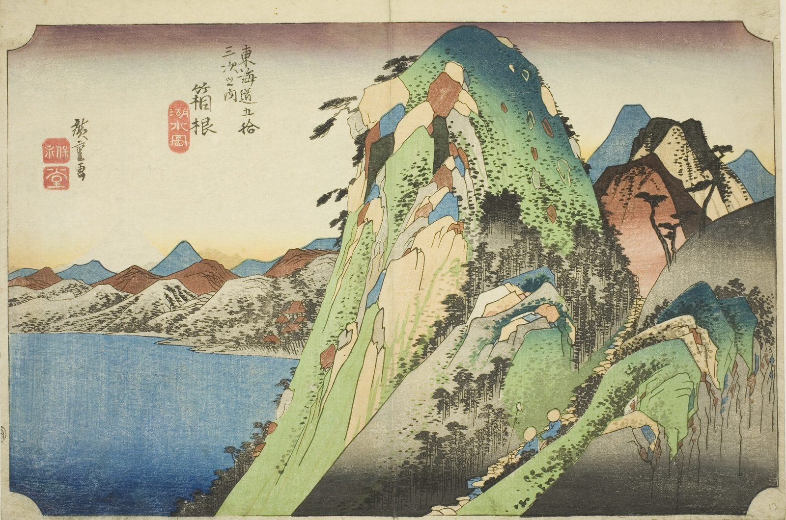

::: {.trail}
[[places|The Road]] / [[Tokyo & Kanagawa]] / Hakone
:::

*Utagawa Hiroshige, 1833–34, colour woodblock. [Full size](../assets/aic-25585.jpg)*

::: {.eyebrow}
Station 10 · Hakone, Kanagawa
:::

::: {.numeral}
10

of 53
:::

::: {.slip}
箱根
:::

::: {.subtitle}
*Hakone, kosui no zu*
:::

> A daimyo procession winds along a jagged mountain trail above Lake Ashi, with the peaks of the Hakone range towering over the water.

::: {.look}
### What to look for

The tiny procession winding down the zigzag path. The rock walls are tilted far steeper than any real mountain, and the lake lies quiet below them.
:::

### Where it falls on the road

::: {.ruler}
25 ri, about 98 km from Nihonbashi.
:::

::: {.credit}
Art Institute of Chicago · Public domain (CC0) · [Source record](https://www.artic.edu/artworks/25585)
:::
