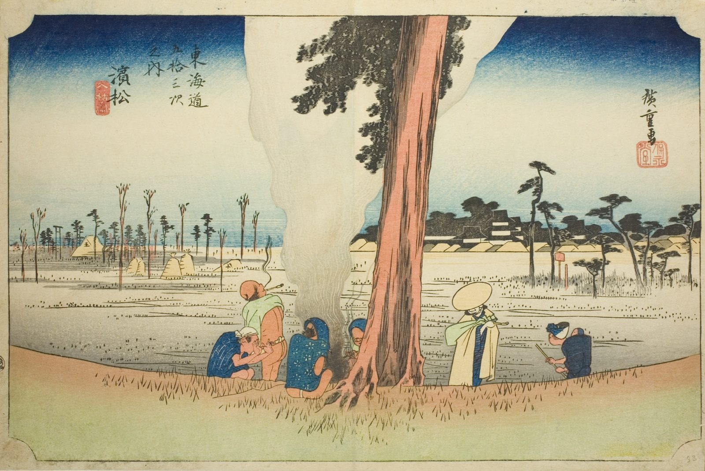

::: {.trail}
[[places|The Road]] / [[Shizuoka]] / Hamamatsu
:::

*Utagawa Hiroshige, 1833–34, colour woodblock. [Full size](../assets/aic-25676.jpg)*

::: {.eyebrow}
Station 29 · Chūō Ward, Hamamatsu, Shizuoka
:::

::: {.numeral}
29

of 53
:::

::: {.slip}
浜松
:::

::: {.subtitle}
*Hamamatsu, fuyugare no zu*
:::

> Travelers warm themselves at a bonfire beneath a huge bare tree on the outskirts of Hamamatsu, Mount Fuji faint in the distance.

::: {.look}
### What to look for

The bonfire under the huge bare tree, and the travellers warming themselves.
:::

### Where it falls on the road

::: {.ruler}
64.7 ri, about 254 km from Nihonbashi.
:::

::: {.credit}
Art Institute of Chicago · Public domain (CC0) · [Source record](https://www.artic.edu/artworks/25676)
:::
