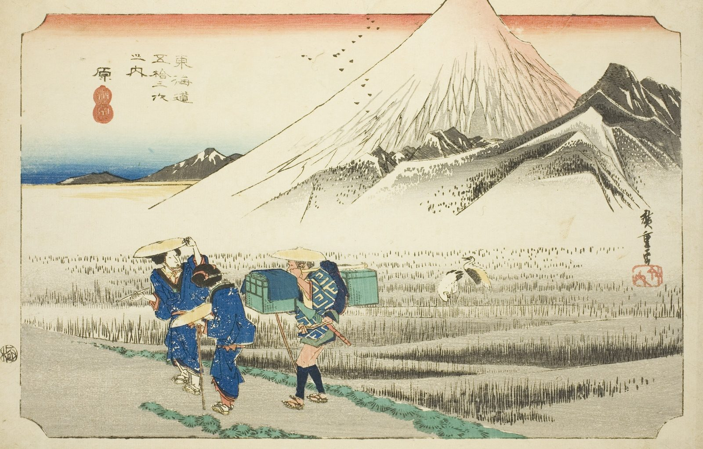

::: {.trail}
[[places|The Road]] / [[Shizuoka]] / Hara
:::

*Utagawa Hiroshige, 1833–34, colour woodblock. [Full size](../assets/aic-13219.jpg)*

::: {.eyebrow}
Station 13 · Hara, Numazu, Shizuoka
:::

::: {.numeral}
13

of 53
:::

::: {.slip}
原
:::

::: {.subtitle}
*Hara, asa no Fuji*
:::

> Two travelers cross a marshy plain at Hara beneath an enormous Mount Fuji filling the sky.

::: {.look}
### What to look for

Fuji is drawn taller than any real view would show, over two small travellers on the marsh.
:::

### Where it falls on the road

::: {.ruler}
31.8 ri, about 125 km from Nihonbashi.
:::

::: {.credit}
Art Institute of Chicago · Public domain (CC0) · [Source record](https://www.artic.edu/artworks/13219)
:::
