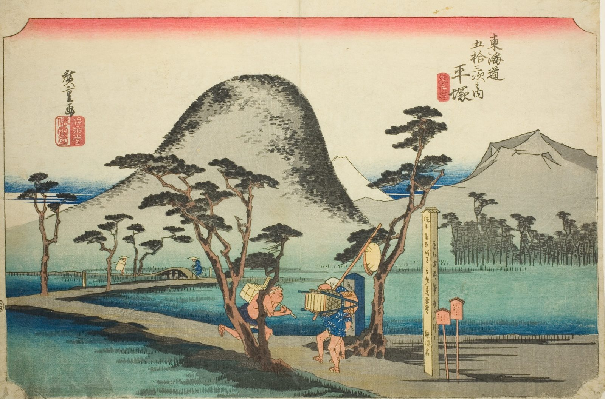

::: {.trail}
[[places|The Road]] / [[Tokyo & Kanagawa]] / Hiratsuka
:::

*Utagawa Hiroshige, 1833–34, colour woodblock. [Full size](../assets/aic-25574.jpg)*

::: {.eyebrow}
Station 7 · Hiratsuka, Kanagawa
:::

::: {.numeral}
7

of 53
:::

::: {.slip}
平塚
:::

::: {.subtitle}
*Hiratsuka, Nawate michi*
:::

> Two travelers hurry along the straight embankment road (nawate) into Hiratsuka with Mount Ōyama rising behind them.

### Where it falls on the road

::: {.ruler}
16 ri, about 63 km from Nihonbashi.
:::

::: {.credit}
Art Institute of Chicago · Public domain (CC0) · [Source record](https://www.artic.edu/artworks/25574)
:::
