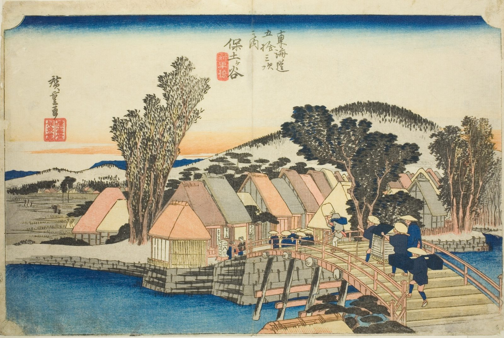

::: {.trail}
[[places|The Road]] / [[Tokyo & Kanagawa]] / Hodogaya
:::

*Utagawa Hiroshige, 1833–34, colour woodblock. [Full size](../assets/aic-25561.jpg)*

::: {.eyebrow}
Station 4 · Hodogaya Ward, Yokohama
:::

::: {.numeral}
4

of 53
:::

::: {.slip}
保土ヶ谷
:::

::: {.subtitle}
*Hodogaya, Shinmachibashi*
:::

> A pack-horse train crosses the Shinmachi Bridge outside Hodogaya beneath windswept pines.

### Where it falls on the road

::: {.ruler}
8.2 ri, about 32 km from Nihonbashi.
:::

::: {.credit}
Art Institute of Chicago · Public domain (CC0) · [Source record](https://www.artic.edu/artworks/25561)
:::
