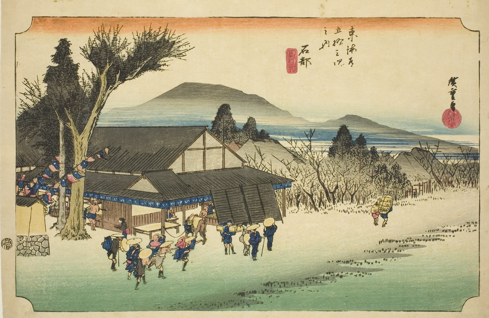

::: {.trail}
[[places|The Road]] / [[Shiga & Kyoto]] / Ishibe
:::

*Utagawa Hiroshige, 1833–34, colour woodblock. [Full size](../assets/aic-18270.jpg)*

::: {.eyebrow}
Station 51 · Ishibe, Kōnan, Shiga
:::

::: {.numeral}
51

of 53
:::

::: {.slip}
石部
:::

::: {.subtitle}
*Ishibe, Megawa no sato*
:::

> Travelers pass through the small hamlet of Megawa near Ishibe as the sun rises over distant hills.

### Where it falls on the road

::: {.ruler}
116.5 ri, about 457 km from Nihonbashi.
:::

::: {.credit}
Art Institute of Chicago · Public domain (CC0) · [Source record](https://www.artic.edu/artworks/18270)
:::
