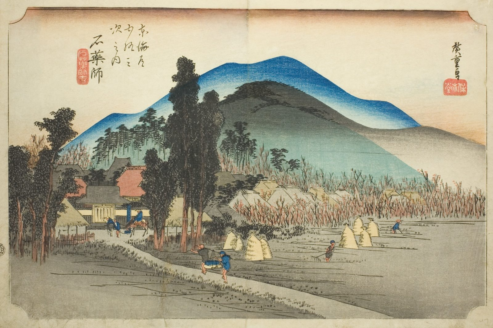

::: {.trail}
[[places|The Road]] / [[Mie]] / Ishiyakushi
:::

*Utagawa Hiroshige, 1833–34, colour woodblock. [Full size](../assets/aic-25759.jpg)*

::: {.eyebrow}
Station 44 · Ishiyakushi, Suzuka, Mie
:::

::: {.numeral}
44

of 53
:::

::: {.slip}
石薬師
:::

::: {.subtitle}
*Ishiyakushi, Ishiyakushiji*
:::

> A quiet view of Ishiyakushi Temple and its surrounding pines is seen from the road, with little traffic on this small station.

### Where it falls on the road

::: {.ruler}
101.9 ri, about 400 km from Nihonbashi.
:::

::: {.credit}
Art Institute of Chicago · Public domain (CC0) · [Source record](https://www.artic.edu/artworks/25759)
:::
