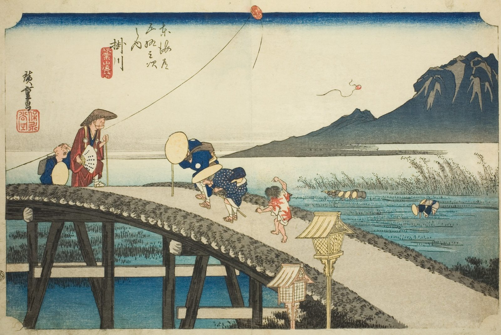

::: {.trail}
[[places|The Road]] / [[Shizuoka]] / Kakegawa
:::

*Utagawa Hiroshige, 1833–34, colour woodblock. [Full size](../assets/aic-25663.jpg)*

> A kite flies over a river crossing near Kakegawa with the sacred peak of Mount Akiba visible on the horizon.

### Where it falls on the road

::: {.ruler}
56.5 ri, about 222 km from Nihonbashi.
:::

::: {.credit}
Art Institute of Chicago · Public domain (CC0) · [Source record](https://www.artic.edu/artworks/25663)
:::
