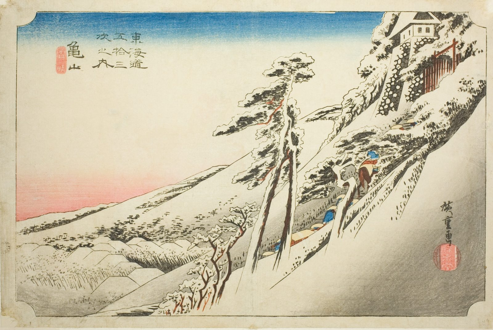

::: {.trail}
[[places|The Road]] / [[Mie]] / Kameyama
:::

*Utagawa Hiroshige, 1833–34, colour woodblock. [Full size](../assets/aic-25762.jpg)*

::: {.eyebrow}
Station 46 · Kameyama, Mie
:::

::: {.numeral}
46

of 53
:::

::: {.slip}
亀山
:::

::: {.subtitle}
*Kameyama, yukibare*
:::

> A procession climbs a steep, snow-covered slope toward Kameyama Castle as the sky clears after a snowfall.

::: {.look}
### What to look for

The procession climbing toward the castle while the sky clears behind the snow.
:::

### Where it falls on the road

::: {.ruler}
104.6 ri, about 411 km from Nihonbashi.
:::

### Rain, snow and mist

<!-- generated:weather -->
:::grid 3 {.weather .weather-strip}
[[Oiso|Rain]]
+++
[[Mishima|Mist]]
+++
[[Kanbara|Snow]]
+++
[[Shono|Driving rain]]
+++
**Snow, clearing**  
This print
+++
[[Tsuchiyama|Spring shower]]
:::
<!-- /generated:weather -->

::: {.credit}
Art Institute of Chicago · Public domain (CC0) · [Source record](https://www.artic.edu/artworks/25762)
:::
