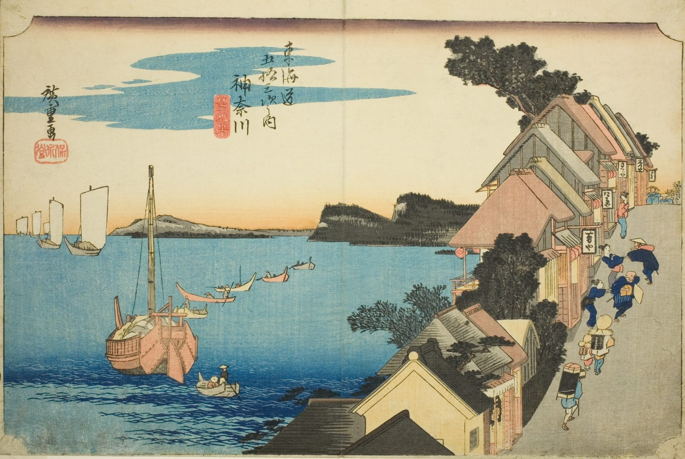

::: {.trail}
[[places|The Road]] / [[Tokyo & Kanagawa]] / Kanagawa
:::

*Utagawa Hiroshige, 1833–34, colour woodblock. [Full size](../assets/aic-25558.jpg)*

::: {.eyebrow}
Station 3 · Kanagawa Ward, Yokohama
:::

::: {.numeral}
3

of 53
:::

::: {.slip}
神奈川
:::

::: {.subtitle}
*Kanagawa, dai no kei*
:::

> Teahouse touts pull at passing travelers along a steep embankment lined with waterside inns overlooking Kanagawa Bay.

### Where it falls on the road

::: {.ruler}
7 ri, about 27 km from Nihonbashi.
:::

::: {.credit}
Art Institute of Chicago · Public domain (CC0) · [Source record](https://www.artic.edu/artworks/25558)
:::
