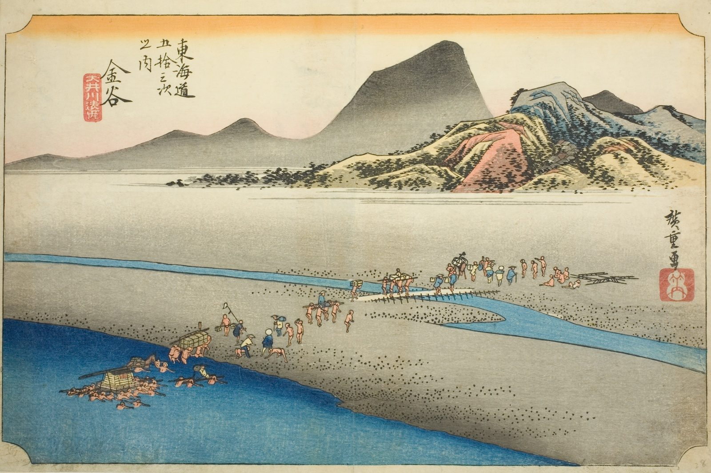

::: {.trail}
[[places|The Road]] / [[Shizuoka]] / Kanaya
:::

*Utagawa Hiroshige, 1833–34, colour woodblock. [Full size](../assets/aic-25657.jpg)*

::: {.eyebrow}
Station 24 · Kanaya, Shimada, Shizuoka
:::

::: {.numeral}
24

of 53
:::

::: {.slip}
金谷
:::

::: {.subtitle}
*Kanaya, Oigawa engan*
:::

> Palanquin bearers wade the Ōi River toward Kanaya on the river's far bank, mountains rising beyond.

### Where it falls on the road

::: {.ruler}
53.1 ri, about 208 km from Nihonbashi.
:::

::: {.credit}
Art Institute of Chicago · Public domain (CC0) · [Source record](https://www.artic.edu/artworks/25657)
:::
