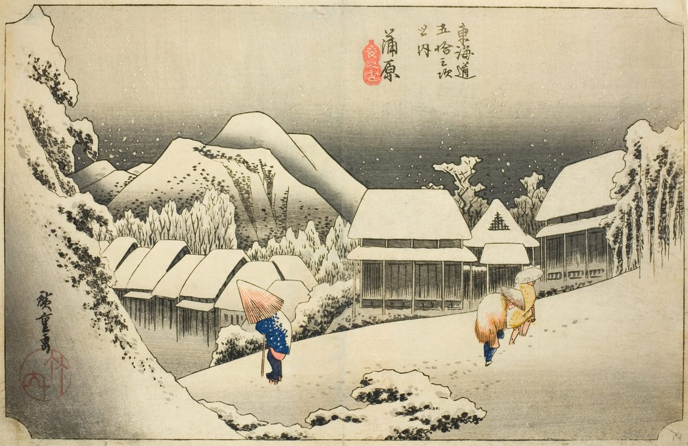

::: {.trail}
[[places|The Road]] / [[Shizuoka]] / Kanbara
:::

*Utagawa Hiroshige, 1833–34, colour woodblock. [Full size](../assets/aic-25613.jpg)*

> Three muffled figures trudge through a silent, heavy snowfall in Kanbara, a scene of snow the town rarely saw.

::: {.look}
### What to look for

The snow is mostly bare paper, and three figures in hats and capes lean into it.
:::

### Where it falls on the road

::: {.ruler}
37.6 ri, about 148 km from Nihonbashi.
:::

### Rain, snow and mist

<!-- generated:weather -->
:::grid 3 {.weather .weather-strip}
[[Oiso|Rain]]
+++
[[Mishima|Mist]]
+++
**Snow**  
This print
+++
[[Shono|Driving rain]]
+++
[[Kameyama|Snow, clearing]]
+++
[[Tsuchiyama|Spring shower]]
:::
<!-- /generated:weather -->

::: {.credit}
Art Institute of Chicago · Public domain (CC0) · [Source record](https://www.artic.edu/artworks/25613)
:::
