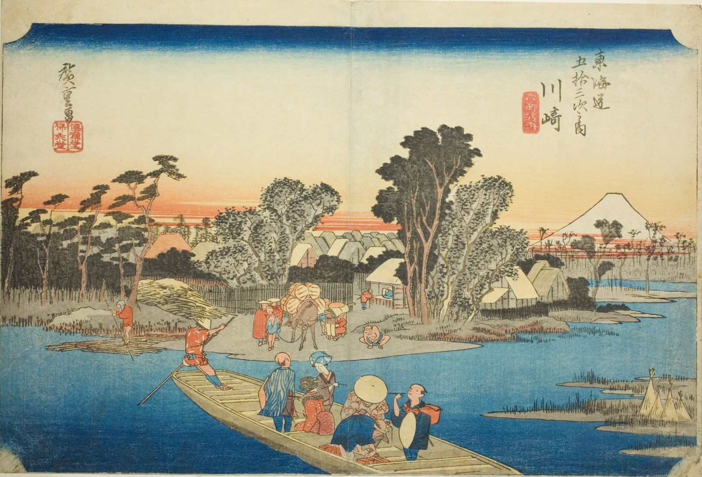

::: {.trail}
[[places|The Road]] / [[Tokyo & Kanagawa]] / Kawasaki
:::

*Utagawa Hiroshige, 1833–34, colour woodblock. [Full size](../assets/aic-25555.jpg)*

::: {.eyebrow}
Station 2 · Kawasaki Ward, Kawasaki, Kanagawa
:::

::: {.numeral}
2

of 53
:::

::: {.slip}
川崎
:::

::: {.subtitle}
*Kawasaki, Rokugo watashibune*
:::

> Travelers and horses wait to board flat-bottomed ferries crossing the Tama River (Rokugo) at Kawasaki, with Mount Fuji faint in the distance.

### Where it falls on the road

::: {.ruler}
4.5 ri, about 18 km from Nihonbashi.
:::

::: {.credit}
Art Institute of Chicago · Public domain (CC0) · [Source record](https://www.artic.edu/artworks/25555)
:::
