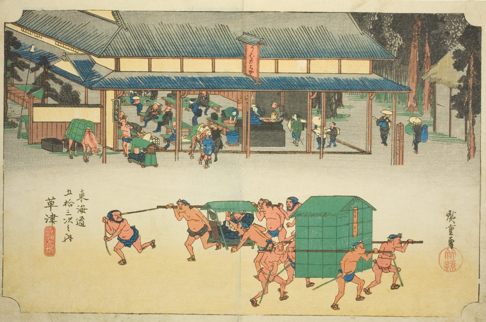

::: {.trail}
[[places|The Road]] / [[Shiga & Kyoto]] / Kusatsu
:::

*Utagawa Hiroshige, 1833–34, colour woodblock. [Full size](../assets/aic-25783.jpg)*

> Palanquin bearers and travelers crowd a large post-house courtyard at Kusatsu, where the Tōkaidō met the Nakasendō.

### Where it falls on the road

::: {.ruler}
119.5 ri, about 469 km from Nihonbashi.
:::

::: {.credit}
Art Institute of Chicago · Public domain (CC0) · [Source record](https://www.artic.edu/artworks/25783)
:::
