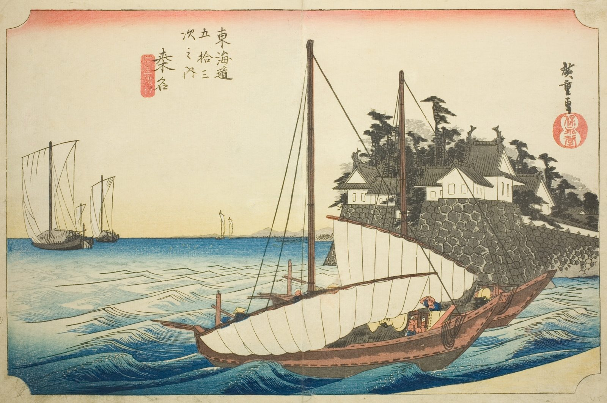

::: {.trail}
[[places|The Road]] / [[Mie]] / Kuwana
:::

*Utagawa Hiroshige, 1833–34, colour woodblock. [Full size](../assets/aic-25748.jpg)*

> Sailboats approach the pier at Kuwana after the seven-ri sea crossing from Miya, since no direct road linked the two towns.

::: {.look}
### What to look for

Sailboats and a pier: the sea crossing from Miya ends here.
:::

### Where it falls on the road

::: {.ruler}
96 ri, about 377 km from Nihonbashi.
:::

::: {.credit}
Art Institute of Chicago · Public domain (CC0) · [Source record](https://www.artic.edu/artworks/25748)
:::
