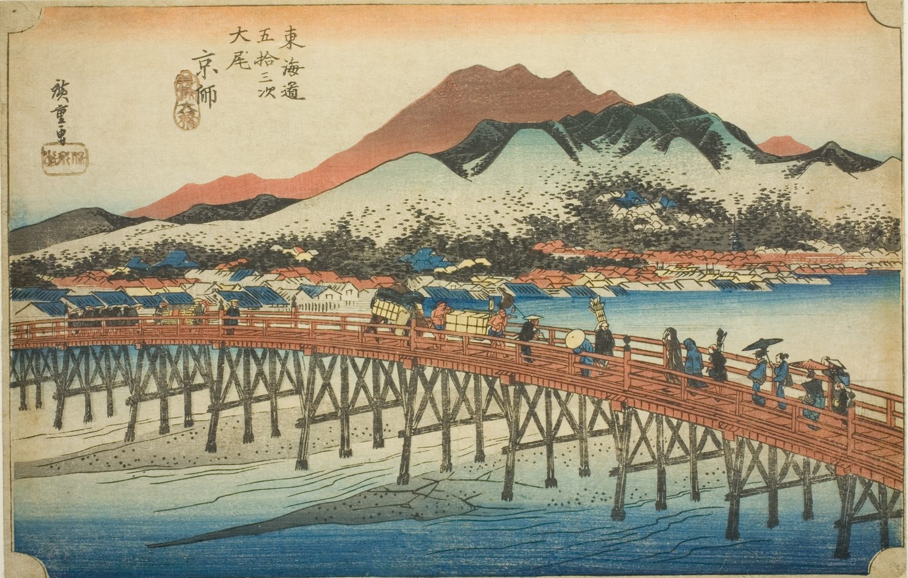

::: {.trail}
[[places|The Road]] / [[Shiga & Kyoto]] / Kyoto
:::

*Utagawa Hiroshige, 1833–34, colour woodblock. [Full size](../assets/aic-25789.jpg)*

::: {.eyebrow}
The end of the road · Nakagyo/Higashiyama Ward, Kyoto
:::

::: {.numeral}
End
:::

::: {.slip}
京都
:::

::: {.subtitle}
*Keishi, Sanjo ohashi*
:::

> Travelers and ox-carts cross the Sanjō Ōhashi bridge into Kyoto, with the city and hills beyond marking the end of the Tōkaidō.

::: {.look}
### What to look for

The Sanjō Ōhashi bridge, ox-carts crossing, the hills of Kyoto behind. This is the end of the road.
:::

### Where it falls on the road

::: {.ruler}
126.2 ri, about 495 km from Nihonbashi: the end of the road.
:::

::: {.credit}
Art Institute of Chicago · Public domain (CC0) · [Source record](https://www.artic.edu/artworks/25789)
:::
