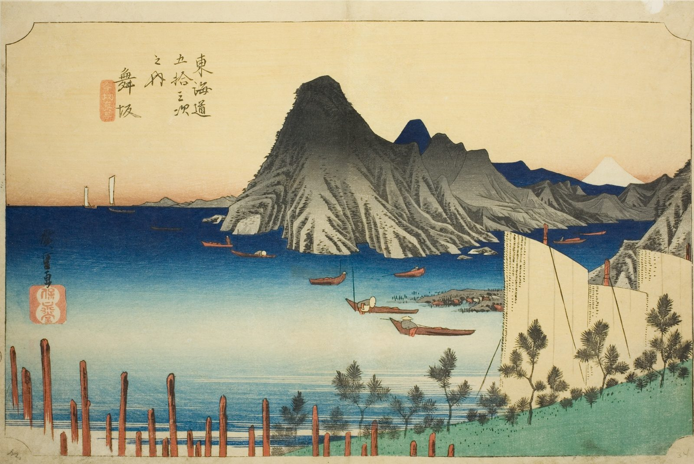

::: {.trail}
[[places|The Road]] / [[Shizuoka]] / Maisaka
:::

*Utagawa Hiroshige, 1833–34, colour woodblock. [Full size](../assets/aic-25683.jpg)*

::: {.eyebrow}
Station 30 · Maisaka, Chūō Ward, Hamamatsu, Shizuoka
:::

::: {.numeral}
30

of 53
:::

::: {.slip}
舞坂
:::

::: {.subtitle}
*Maisaka, Imagiri shinkei*
:::

> Sailboats cross the calm waters of Lake Hamana at the Imagiri crossing near Maisaka, with Mount Fuji on the horizon.

### Where it falls on the road

::: {.ruler}
67.4 ri, about 265 km from Nihonbashi.
:::

::: {.credit}
Art Institute of Chicago · Public domain (CC0) · [Source record](https://www.artic.edu/artworks/25683)
:::
