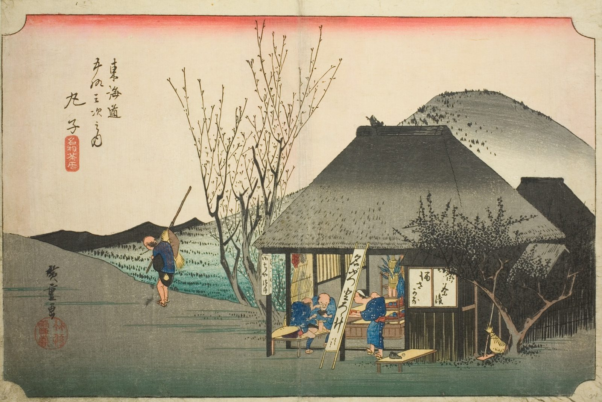

::: {.trail}
[[places|The Road]] / [[Shizuoka]] / Mariko
:::

*Utagawa Hiroshige, 1833–34, colour woodblock. [Full size](../assets/aic-25630.jpg)*

> Travelers stop at a thatched roadside teahouse in Mariko famous for its grated-yam (tororo) soup, served by a woman with a child.

### Where it falls on the road

::: {.ruler}
46.1 ri, about 181 km from Nihonbashi.
:::

::: {.credit}
Art Institute of Chicago · Public domain (CC0) · [Source record](https://www.artic.edu/artworks/25630)
:::
