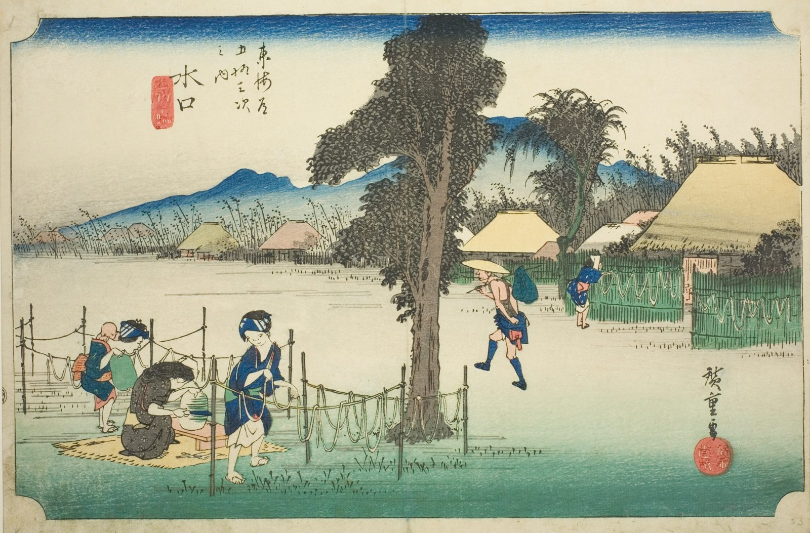

::: {.trail}
[[places|The Road]] / [[Shiga & Kyoto]] / Minakuchi
:::

*Utagawa Hiroshige, 1833–34, colour woodblock. [Full size](../assets/aic-25775.jpg)*

::: {.eyebrow}
Station 50 · Minakuchi, Kōka, Shiga
:::

::: {.numeral}
50

of 53
:::

::: {.slip}
水口
:::

::: {.subtitle}
*Minakuchi, meibutsu kanpyo*
:::

> Women prepare and dry kanpyō (gourd shavings), the local specialty of Minakuchi, on racks outside a farmhouse.

### Where it falls on the road

::: {.ruler}
113 ri, about 444 km from Nihonbashi.
:::

::: {.credit}
Art Institute of Chicago · Public domain (CC0) · [Source record](https://www.artic.edu/artworks/25775)
:::
