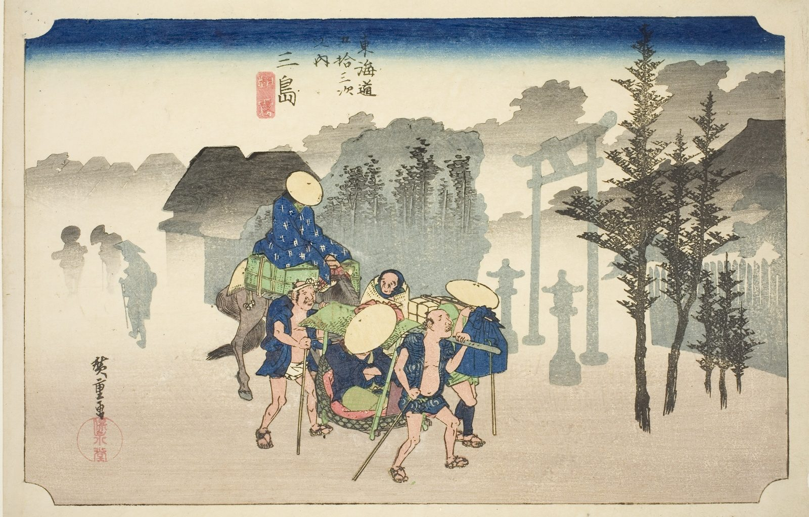

::: {.trail}
[[places|The Road]] / [[Shizuoka]] / Mishima
:::

*Utagawa Hiroshige, 1833–34, colour woodblock. [Full size](../assets/aic-10926.jpg)*

::: {.eyebrow}
Station 11 · Mishima, Shizuoka
:::

::: {.numeral}
11

of 53
:::

::: {.slip}
三島
:::

::: {.subtitle}
*Mishima, asagiri*
:::

> Travelers and a packhorse emerge from thick morning fog near the torii gate of Mishima Taisha, Mount Fuji hidden entirely from view.

::: {.look}
### What to look for

The mist is a smooth fade of colour, and the shrine gate and travellers come out of it; Fuji is somewhere behind.
:::

### Where it falls on the road

::: {.ruler}
28.8 ri, about 113 km from Nihonbashi.
:::

### Rain, snow and mist

<!-- generated:weather -->
:::grid 3 {.weather .weather-strip}
[[Oiso|Rain]]
+++
**Mist**  
This print
+++
[[Kanbara|Snow]]
+++
[[Shono|Driving rain]]
+++
[[Kameyama|Snow, clearing]]
+++
[[Tsuchiyama|Spring shower]]
:::
<!-- /generated:weather -->

::: {.credit}
Art Institute of Chicago · Public domain (CC0) · [Source record](https://www.artic.edu/artworks/10926)
:::
