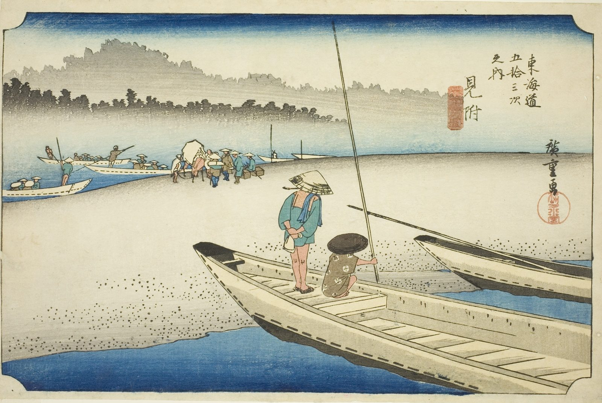

::: {.trail}
[[places|The Road]] / [[Shizuoka]] / Mitsuke
:::

*Utagawa Hiroshige, 1833–34, colour woodblock. [Full size](../assets/aic-18262.jpg)*

> Ferrymen pole passengers across the broad Tenryū River near Mitsuke, with sandbars and distant hills beyond.

### Where it falls on the road

::: {.ruler}
60.5 ri, about 238 km from Nihonbashi.
:::

::: {.credit}
Art Institute of Chicago · Public domain (CC0) · [Source record](https://www.artic.edu/artworks/18262)
:::
