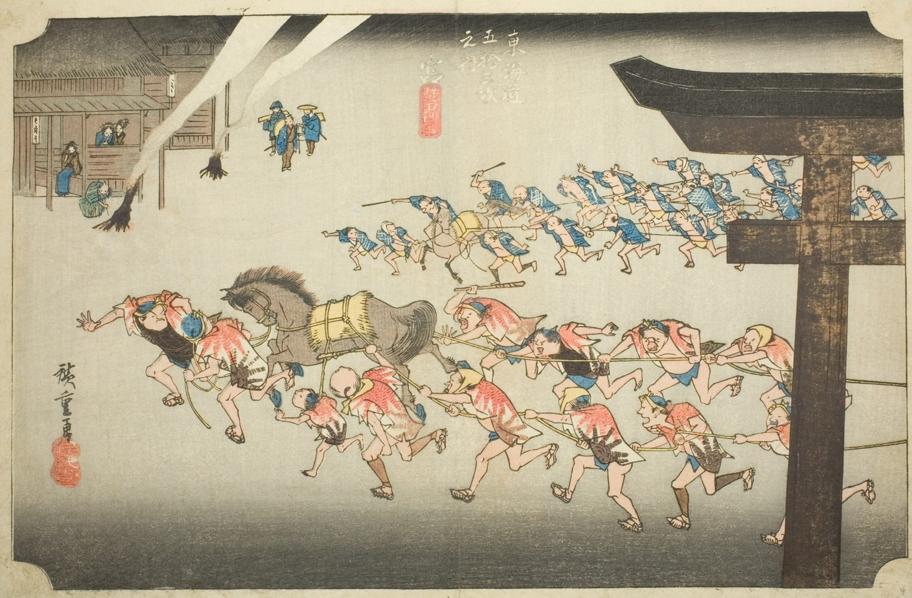

::: {.trail}
[[places|The Road]] / [[Aichi]] / Miya
:::

*Utagawa Hiroshige, 1833–34, colour woodblock. [Full size](../assets/aic-25744.jpg)*

> Wrestlers perform sumo before a crowd during a festival at Atsuta Shrine, the landmark of the port town of Miya.

### Where it falls on the road

::: {.ruler}
89 ri, about 349 km from Nihonbashi.
:::

::: {.credit}
Art Institute of Chicago · Public domain (CC0) · [Source record](https://www.artic.edu/artworks/25744)
:::
