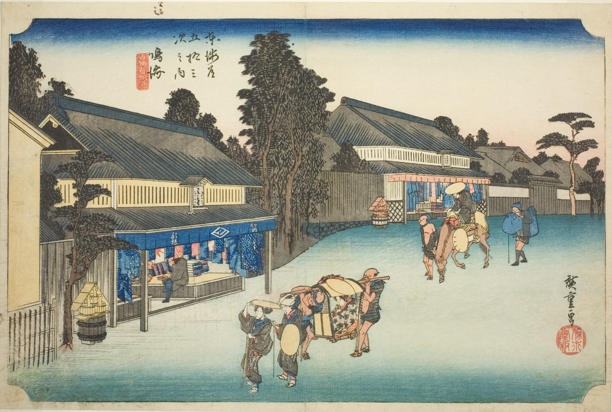

::: {.trail}
[[places|The Road]] / [[Aichi]] / Narumi
:::

*Utagawa Hiroshige, 1833–34, colour woodblock. [Full size](../assets/aic-25741.jpg)*

> Shops in Narumi display bolts of the tie-dyed cotton (Arimatsu shibori) for which the town was famous, as travelers browse.

### Where it falls on the road

::: {.ruler}
87.3 ri, about 343 km from Nihonbashi.
:::

::: {.credit}
Art Institute of Chicago · Public domain (CC0) · [Source record](https://www.artic.edu/artworks/25741)
:::
