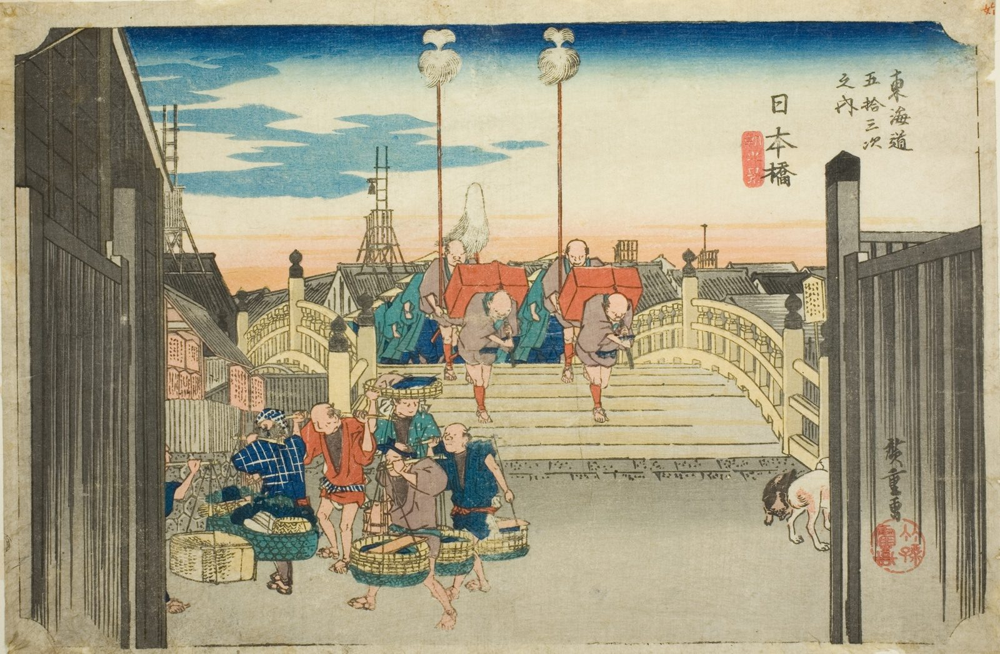

::: {.trail}
[[places|The Road]] / [[Tokyo & Kanagawa]] / Nihonbashi
:::

*Utagawa Hiroshige, 1833–34, colour woodblock. [Full size](../assets/aic-25544.jpg)*

::: {.eyebrow}
The start of the road · Chūō, Tokyo
:::

::: {.numeral}
Start
:::

::: {.slip}
日本橋
:::

::: {.subtitle}
*Nihonbashi, asa no kei*
:::

> A daimyo procession sets off across Nihonbashi at dawn as fish vendors and porters crowd the bridgehead, marking the start of the Tōkaidō in Edo.

::: {.look}
### What to look for

Fish vendors and porters crowd the bridgehead as the procession sets out, and the city is still in dawn light.
:::

### Where it falls on the road

::: {.ruler}
The start of the road, nothing to walk yet.
:::

::: {.credit}
Art Institute of Chicago · Public domain (CC0) · [Source record](https://www.artic.edu/artworks/25544)
:::
