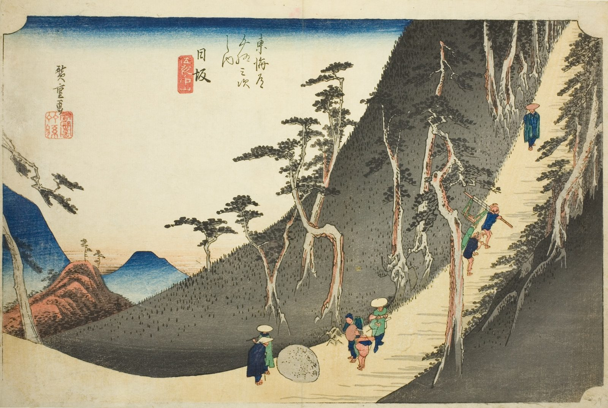

::: {.trail}
[[places|The Road]] / [[Shizuoka]] / Nissaka
:::

*Utagawa Hiroshige, 1833–34, colour woodblock. [Full size](../assets/aic-25660.jpg)*

::: {.eyebrow}
Station 25 · Nissaka, Kakegawa, Shizuoka
:::

::: {.numeral}
25

of 53
:::

::: {.slip}
日坂
:::

::: {.subtitle}
*Nissaka, Sayo no nakayama*
:::

> A traveler rests beside a huge roadside boulder on the steep Sayo-no-Nakayama pass above Nissaka.

### Where it falls on the road

::: {.ruler}
54.7 ri, about 215 km from Nihonbashi.
:::

::: {.credit}
Art Institute of Chicago · Public domain (CC0) · [Source record](https://www.artic.edu/artworks/25660)
:::
