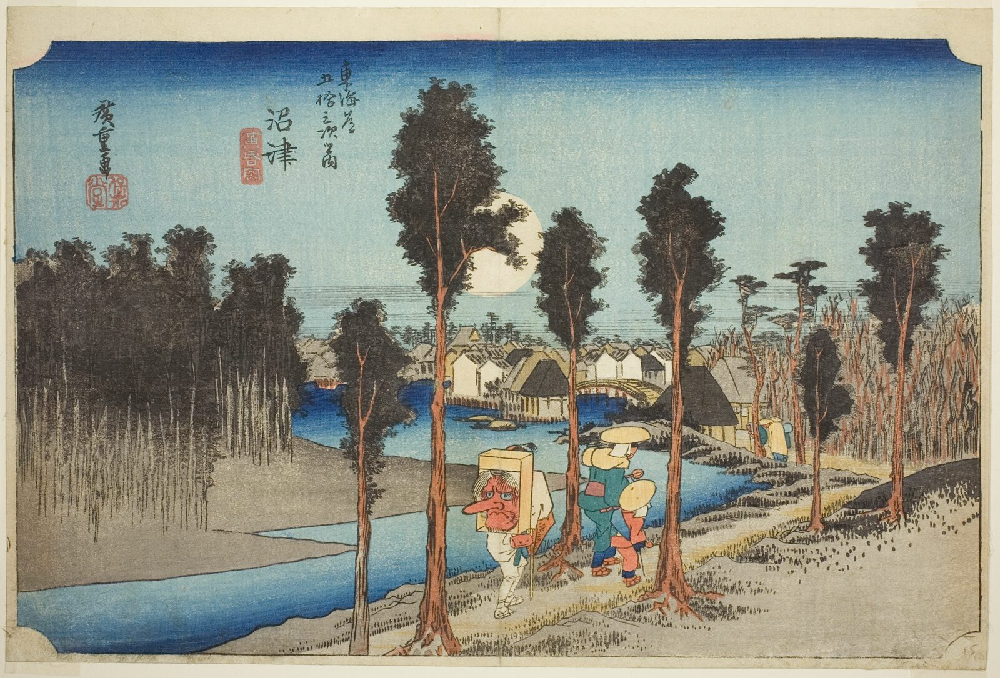

::: {.trail}
[[places|The Road]] / [[Shizuoka]] / Numazu
:::

*Utagawa Hiroshige, 1833–34, colour woodblock. [Full size](../assets/aic-25594.jpg)*

> A pilgrim in a tengu mask and a pack-laden traveler walk along the Kano River at dusk beneath a full moon, geese overhead.

::: {.look}
### What to look for

The traveller with a tengu mask on his back, the full moon, and the geese crossing the sky.
:::

### Where it falls on the road

::: {.ruler}
30.3 ri, about 119 km from Nihonbashi.
:::

::: {.credit}
Art Institute of Chicago · Public domain (CC0) · [Source record](https://www.artic.edu/artworks/25594)
:::
