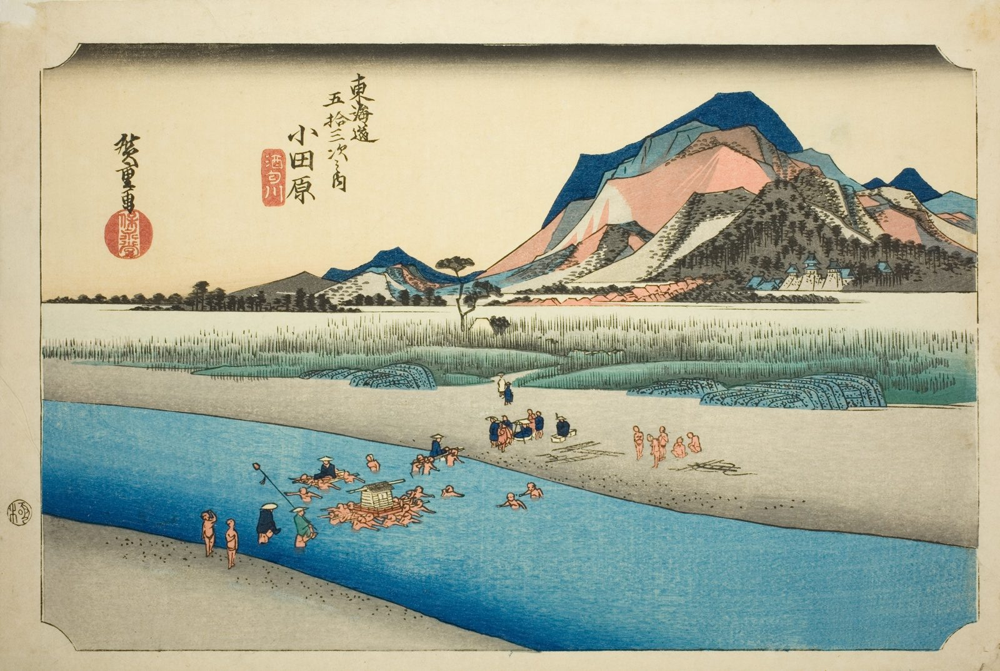

::: {.trail}
[[places|The Road]] / [[Tokyo & Kanagawa]] / Odawara
:::

*Utagawa Hiroshige, 1833–34, colour woodblock. [Full size](../assets/aic-18253.jpg)*

> Porters carry a palanquin and baggage across the shallow Sakawa River on the approach to Odawara Castle, visible on the far bank.

### Where it falls on the road

::: {.ruler}
20.8 ri, about 81 km from Nihonbashi.
:::

::: {.credit}
Art Institute of Chicago · Public domain (CC0) · [Source record](https://www.artic.edu/artworks/18253)
:::
