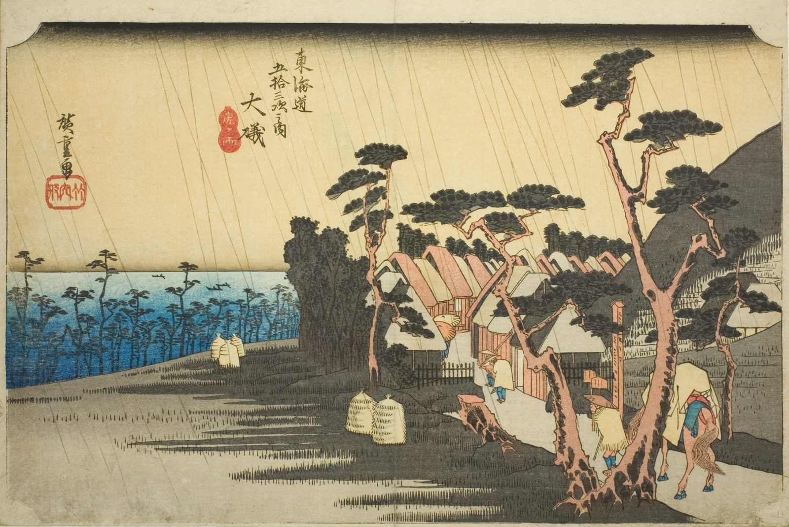

::: {.trail}
[[places|The Road]] / [[Tokyo & Kanagawa]] / Oiso
:::

*Utagawa Hiroshige, 1833–34, colour woodblock. [Full size](../assets/aic-25579.jpg)*

::: {.eyebrow}
Station 8 · Ōiso, Kanagawa
:::

::: {.numeral}
8

of 53
:::

::: {.slip}
大磯
:::

::: {.subtitle}
*Oiso, Tora ga ame*
:::

> Travelers are caught in a sudden shower on the shore road at Ōiso, a rain traditionally called "Tora ga ame" after the legendary courtesan Tora.

### Where it falls on the road

::: {.ruler}
16.8 ri, about 66 km from Nihonbashi.
:::

### Rain, snow and mist

<!-- generated:weather -->
:::grid 3 {.weather .weather-strip}
**Rain**  
This print
+++
[[Mishima|Mist]]
+++
[[Kanbara|Snow]]
+++
[[Shono|Driving rain]]
+++
[[Kameyama|Snow, clearing]]
+++
[[Tsuchiyama|Spring shower]]
:::
<!-- /generated:weather -->

::: {.credit}
Art Institute of Chicago · Public domain (CC0) · [Source record](https://www.artic.edu/artworks/25579)
:::
