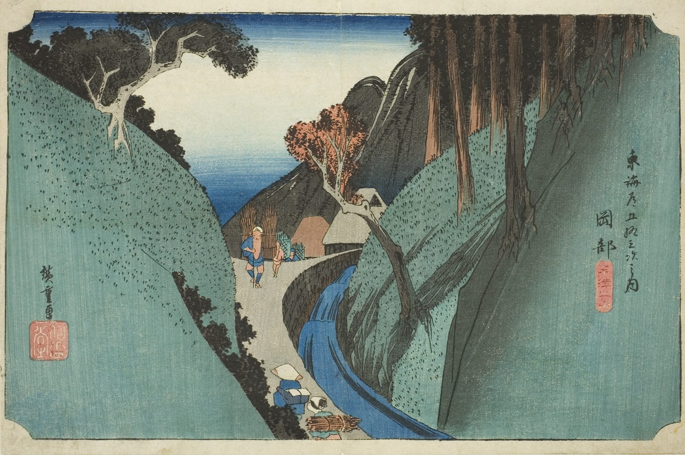

::: {.trail}
[[places|The Road]] / [[Shizuoka]] / Okabe
:::

*Utagawa Hiroshige, 1833–34, colour woodblock. [Full size](../assets/aic-18260.jpg)*

> A line of travelers threads a narrow, tree-shaded mountain path over the Utsu Pass near Okabe.

### Where it falls on the road

::: {.ruler}
48.1 ri, about 189 km from Nihonbashi.
:::

::: {.credit}
Art Institute of Chicago · Public domain (CC0) · [Source record](https://www.artic.edu/artworks/18260)
:::
