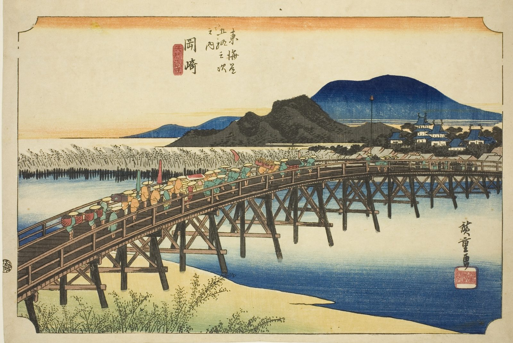

::: {.trail}
[[places|The Road]] / [[Aichi]] / Okazaki
:::

*Utagawa Hiroshige, 1833–34, colour woodblock. [Full size](../assets/aic-18268.jpg)*

> A daimyo procession crosses the immense Yahagi Bridge into Okazaki beneath its castle, one of the longest bridges on the Tōkaidō.

### Where it falls on the road

::: {.ruler}
80.7 ri, about 317 km from Nihonbashi.
:::

::: {.credit}
Art Institute of Chicago · Public domain (CC0) · [Source record](https://www.artic.edu/artworks/18268)
:::
