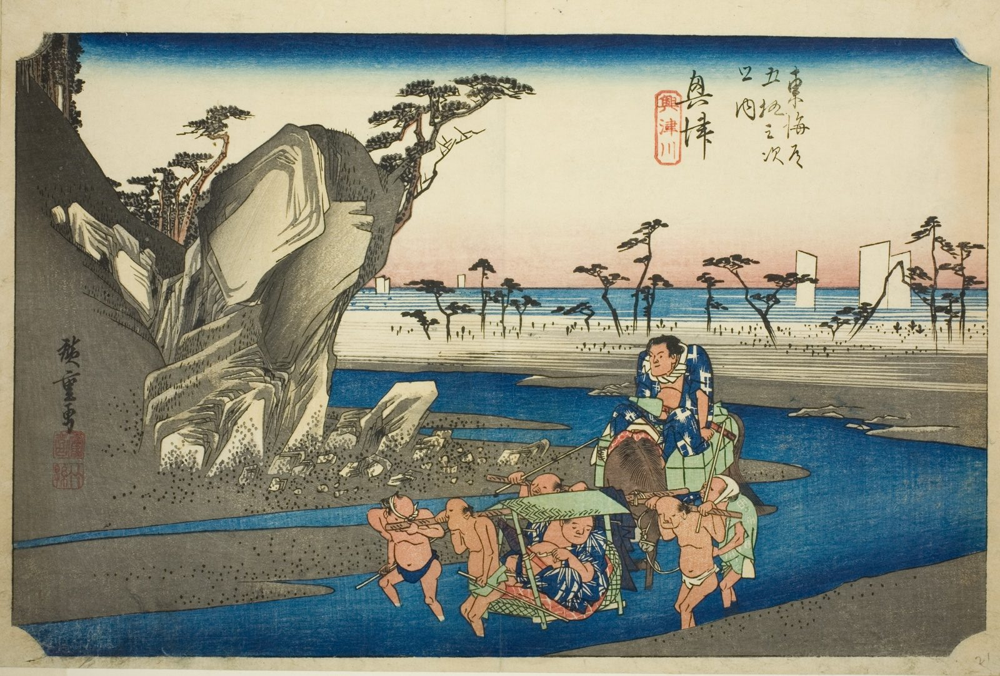

::: {.trail}
[[places|The Road]] / [[Shizuoka]] / Okitsu
:::

*Utagawa Hiroshige, 1833–34, colour woodblock. [Full size](../assets/aic-25618.jpg)*

::: {.eyebrow}
Station 17 · Okitsu, Shimizu-ku, Shizuoka City
:::

::: {.numeral}
17

of 53
:::

::: {.slip}
興津
:::

::: {.subtitle}
*Okitsu, Okitsugawa*
:::

> Porters ford the shallow Okitsu River carrying a mounted traveler and baggage toward the town.

### Where it falls on the road

::: {.ruler}
40.9 ri, about 161 km from Nihonbashi.
:::

::: {.credit}
Art Institute of Chicago · Public domain (CC0) · [Source record](https://www.artic.edu/artworks/25618)
:::
