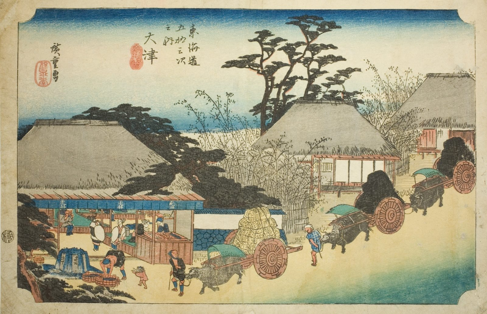

::: {.trail}
[[places|The Road]] / [[Shiga & Kyoto]] / Ōtsu
:::

*Utagawa Hiroshige, 1833–34, colour woodblock. [Full size](../assets/aic-25785.jpg)*

> Ox-carts loaded with goods pass a well-known teahouse at the edge of Ōtsu on the final approach to Kyoto.

### Where it falls on the road

::: {.ruler}
123.2 ri, about 484 km from Nihonbashi.
:::

::: {.credit}
Art Institute of Chicago · Public domain (CC0) · [Source record](https://www.artic.edu/artworks/25785)
:::
