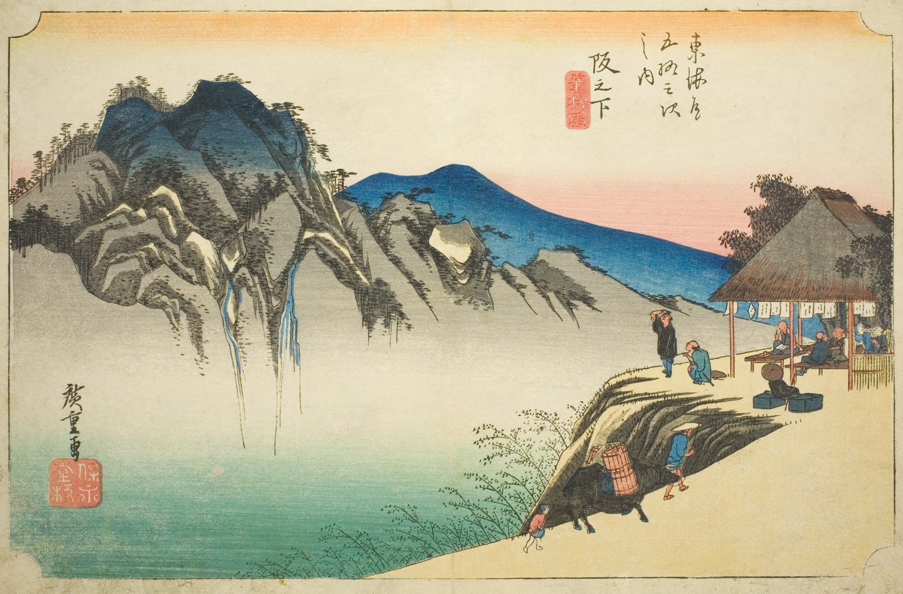

::: {.trail}
[[places|The Road]] / [[Mie]] / Sakanoshita
:::

*Utagawa Hiroshige, 1833–34, colour woodblock. [Full size](../assets/aic-25769.jpg)*

::: {.eyebrow}
Station 48 · Sakashita, Kameyama, Mie
:::

::: {.numeral}
48

of 53
:::

::: {.slip}
坂下
:::

::: {.subtitle}
*Sakanoshita, Fudesute mine*
:::

> Travelers pause at a teahouse overlooking a dramatic gorge and waterfall near the peak of Fudesute-yama.

### Where it falls on the road

::: {.ruler}
107.8 ri, about 423 km from Nihonbashi.
:::

::: {.credit}
Art Institute of Chicago · Public domain (CC0) · [Source record](https://www.artic.edu/artworks/25769)
:::
