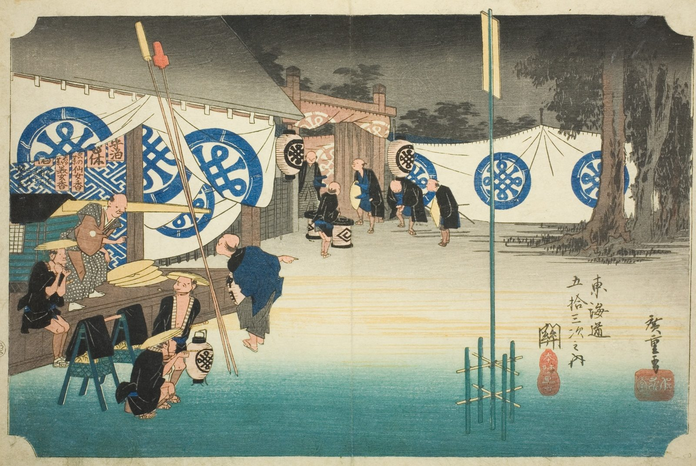

::: {.trail}
[[places|The Road]] / [[Mie]] / Seki
:::

*Utagawa Hiroshige, 1833–34, colour woodblock. [Full size](../assets/aic-25766.jpg)*

::: {.eyebrow}
Station 47 · Seki, Kameyama, Mie
:::

::: {.numeral}
47

of 53
:::

::: {.slip}
関
:::

::: {.subtitle}
*Seki, honjin hayadachi*
:::

> Porters and a palanquin assemble in the pre-dawn dark outside the honjin (main inn) at Seki as a party prepares to depart.

### Where it falls on the road

::: {.ruler}
106.1 ri, about 417 km from Nihonbashi.
:::

::: {.credit}
Art Institute of Chicago · Public domain (CC0) · [Source record](https://www.artic.edu/artworks/25766)
:::
