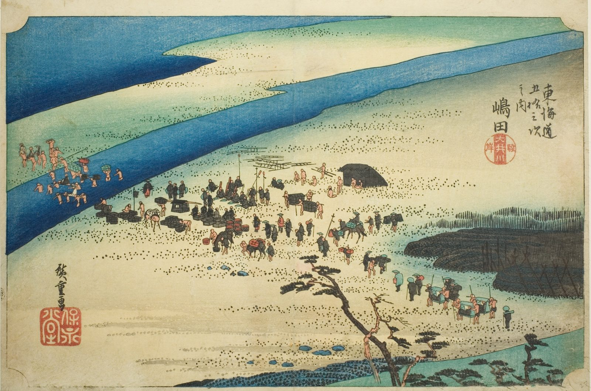

::: {.trail}
[[places|The Road]] / [[Shizuoka]] / Shimada
:::

*Utagawa Hiroshige, 1833–34, colour woodblock. [Full size](../assets/aic-25653.jpg)*

::: {.eyebrow}
Station 23 · Shimada, Shizuoka
:::

::: {.numeral}
23

of 53
:::

::: {.slip}
島田
:::

::: {.subtitle}
*Shimada, Oigawa Sungan*
:::

> Porters and mounted travelers gather on the Suruga-side bank of the Ōi River at Shimada, waiting to be carried across since no bridge was permitted.

### Where it falls on the road

::: {.ruler}
52.1 ri, about 204 km from Nihonbashi.
:::

::: {.credit}
Art Institute of Chicago · Public domain (CC0) · [Source record](https://www.artic.edu/artworks/25653)
:::
