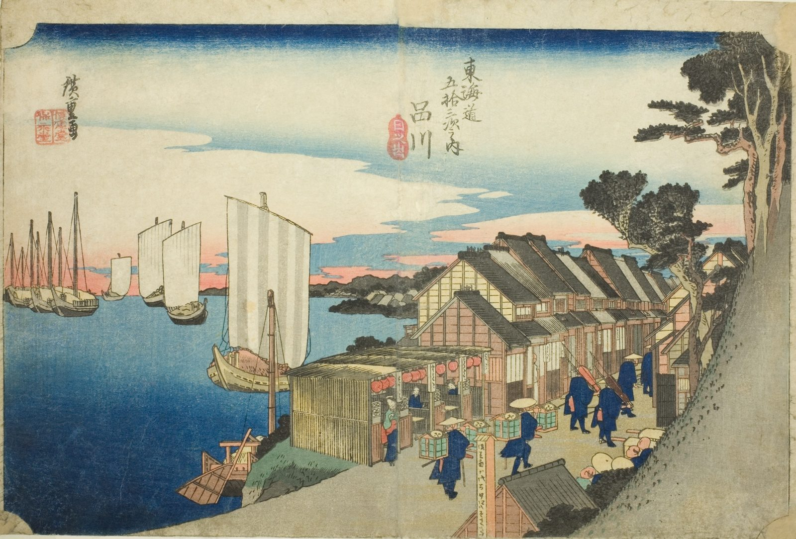

::: {.trail}
[[places|The Road]] / [[Tokyo & Kanagawa]] / Shinagawa
:::

*Utagawa Hiroshige, 1833–34, colour woodblock. [Full size](../assets/aic-25551.jpg)*

::: {.eyebrow}
Station 1 · Shinagawa, Tokyo
:::

::: {.numeral}
1

of 53
:::

::: {.slip}
品川
:::

::: {.subtitle}
*Shinagawa, hinode*
:::

> A daimyo's retinue departs from the inns of Shinagawa at sunrise, with the bay and moored boats visible beyond the rooftops.

### Where it falls on the road

::: {.ruler}
2 ri, about 8 km from Nihonbashi.
:::

::: {.credit}
Art Institute of Chicago · Public domain (CC0) · [Source record](https://www.artic.edu/artworks/25551)
:::
