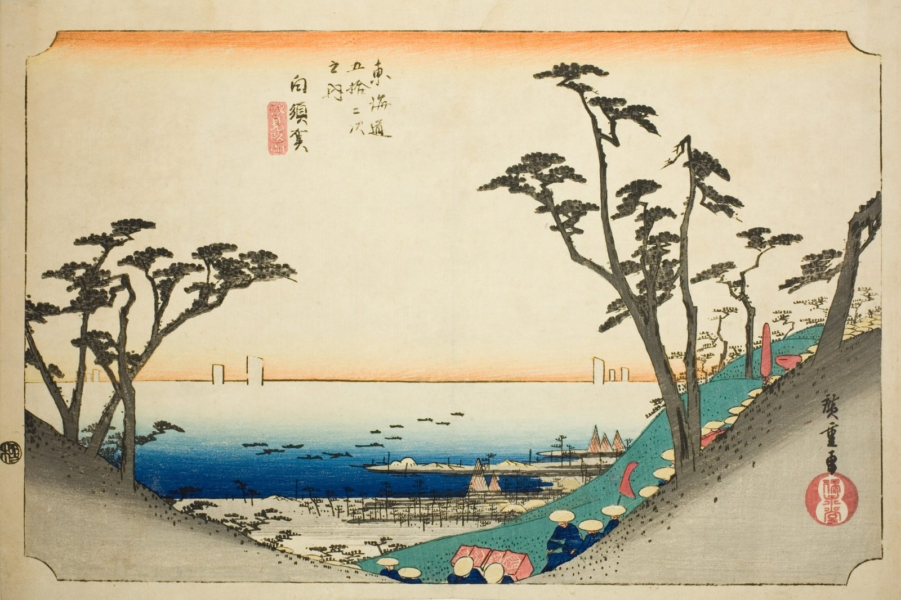

::: {.trail}
[[places|The Road]] / [[Shizuoka]] / Shirasuka
:::

*Utagawa Hiroshige, 1833–34, colour woodblock. [Full size](../assets/aic-25701.jpg)*

::: {.eyebrow}
Station 32 · Shirasuka, Kosai, Shizuoka
:::

::: {.numeral}
32

of 53
:::

::: {.slip}
白須賀
:::

::: {.subtitle}
*Shirasuka, Shiomizaka zu*
:::

> Travelers pause on the Shiomizaka hillside above Shirasuka, where the road briefly opens onto a view of the sea.

### Where it falls on the road

::: {.ruler}
70.6 ri, about 277 km from Nihonbashi.
:::

::: {.credit}
Art Institute of Chicago · Public domain (CC0) · [Source record](https://www.artic.edu/artworks/25701)
:::
