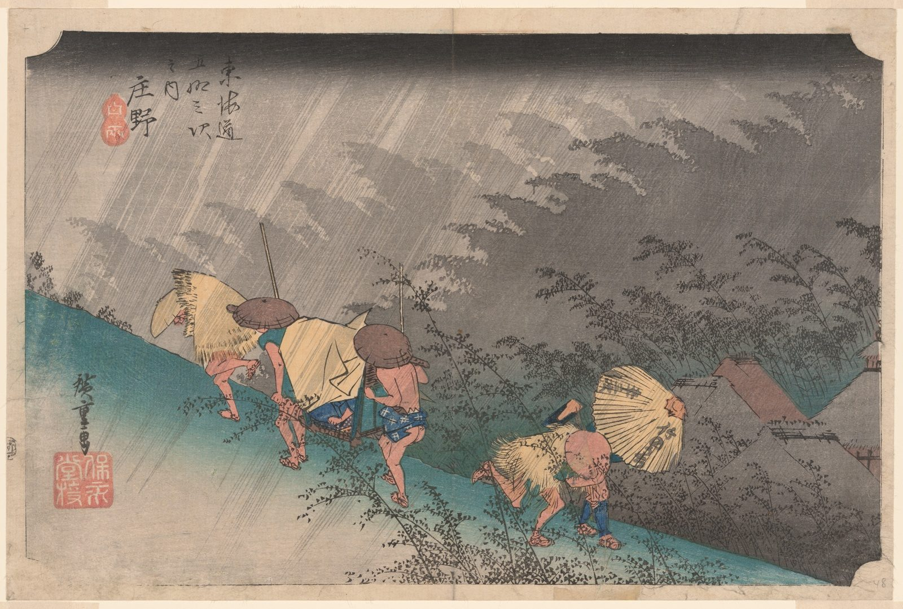

::: {.trail}
[[places|The Road]] / [[Mie]] / Shōno
:::

*Utagawa Hiroshige, 1833–34, colour woodblock. [Full size](../assets/aic-25761.jpg)*

::: {.eyebrow}
Station 45 · Shōno, Suzuka, Mie
:::

::: {.numeral}
45

of 53
:::

::: {.slip}
庄野
:::

::: {.subtitle}
*Shono hakuu*
:::

> Travelers and porters are caught in a sudden, driving rainstorm as they hurry along the road at Shōno.

::: {.look}
### What to look for

The rain is drawn as slanting lines, and the bamboo and the hurrying travellers bend with it.
:::

### Where it falls on the road

::: {.ruler}
102.6 ri, about 403 km from Nihonbashi.
:::

### Rain, snow and mist

<!-- generated:weather -->
:::grid 3 {.weather .weather-strip}
[[Oiso|Rain]]
+++
[[Mishima|Mist]]
+++
[[Kanbara|Snow]]
+++
**Driving rain**  
This print
+++
[[Kameyama|Snow, clearing]]
+++
[[Tsuchiyama|Spring shower]]
:::
<!-- /generated:weather -->

::: {.credit}
Art Institute of Chicago · Public domain (CC0) · [Source record](https://www.artic.edu/artworks/25761)
:::
