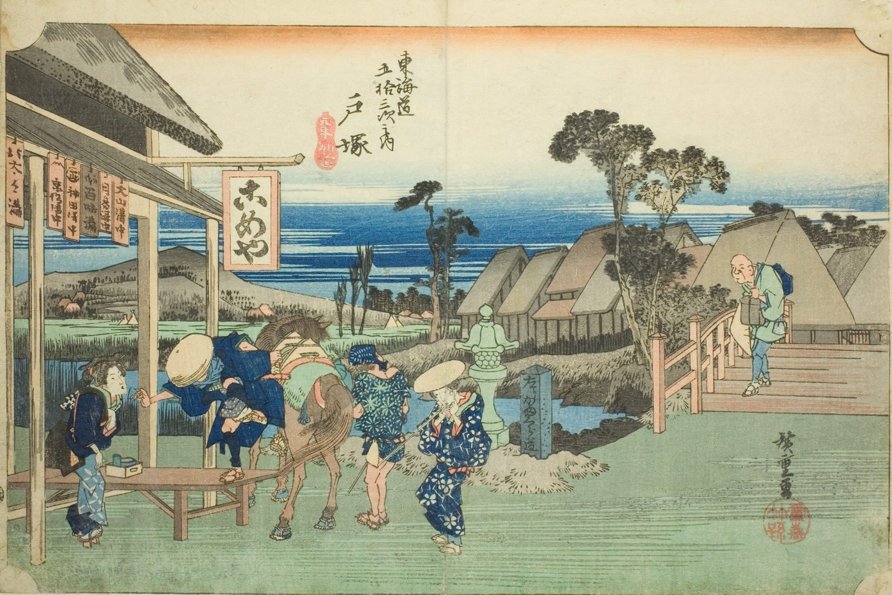

::: {.trail}
[[places|The Road]] / [[Tokyo & Kanagawa]] / Totsuka
:::

*Utagawa Hiroshige, 1833–34, colour woodblock. [Full size](../assets/aic-25563.jpg)*

> A traveler dismounts at a horse-changing station where the road forks at Motomachi, near Totsuka.

### Where it falls on the road

::: {.ruler}
10.5 ri, about 41 km from Nihonbashi.
:::

::: {.credit}
Art Institute of Chicago · Public domain (CC0) · [Source record](https://www.artic.edu/artworks/25563)
:::
